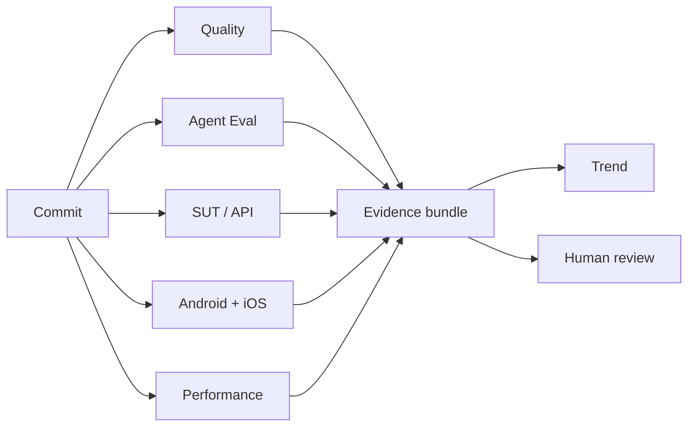
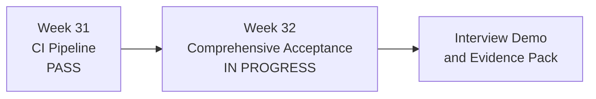

# WEEK-32 - 综合验收、Agent Eval 与面试证据包 / Comprehensive Acceptance, Agent Eval, and Interview Evidence

- 计划 / Plan: Week 32，完整业务链路、统一质量流水线、Agent Golden Tasks、面试证据包
- 计划日期范围 / Planned Date Range: 2026-12-17 to 2026-12-23
- 实际开启日期 / Opened: 2026-11-20
- 当前工作区 / Current Worktree:
  `C:\Users\quan\.codex\worktrees\week30-ios-cloud-performance\Appium 2 study`
- 当前分支 / Current Branch: `study/week-32-comprehensive-acceptance`
- 基线提交 / Base Commit: `ce26ac5`（Week 31 complete）
- 状态 / Status: **进行中 / IN PROGRESS**

## 计划目标 / Plan Goal

Week 32 把前 31 周的 API、数据库、缓存、Android、iOS、性能、CI、趋势和缺陷
能力收束为可演示、可审计、可复述的完整质量平台：

```text
one commit
-> quality + SUT + Android + iOS Simulator + performance + Agent Eval
-> machine-readable evidence
-> bounded trends
-> human review
-> interview-ready demonstration
```

本周末尾不能只展示目录或设计文档。API 修复、移动端、CI、性能和 Agent 指标必须
有真实执行证据；外部阻断和未执行项保持原状态。

## 本地已完成 / Local Completed

- 修复 Issue [#16](https://github.com/htb123-maker/quality-engineering-lab/issues/16)：
  SUT unsupported HTTP methods 从 HTML 501 改为 JSON 405。
- `Allow` 统一返回 `GET, POST, PATCH, DELETE`。
- PUT、OPTIONS、TRACE、CONNECT 和 HEAD 都有真实 API 回归。
- 新增确定性只读证据分诊 Agent 和 30 个 Golden Tasks。
- 记录一次 Agent false-pass 误判、修正和回归：
  `ai/evals/regressions/missing-evidence-false-pass.md`。
- 新增 5 个只读 Agent 注册表：performance、flaky、CI、iOS environment、
  weekly maintenance。
- 注册表强制只读工具、无 Shell、无仓库写、无缺陷创建/关闭、无阈值修改、无发布。
- 统一 pipeline 新增必需 `ai-eval` job，并将结果纳入 quality trend。
- 新增综合验收 ADR、架构文档和面试证据包。

## 本地验证 / Local Verification

| Check | Result | Evidence |
| --- | --- | --- |
| Issue #16 real Compose SUT regression | PASS | `5 passed in 0.71s` |
| Full unit regression | PASS | `393 passed in 8.78s` |
| Ruff | PASS | `All checks passed!` |
| Mypy | PASS | `Success: no issues found in 232 source files` |
| Governance | PASS | `quality governance valid: 0 quarantined tests` |
| Agent Golden Tasks | PASS | 30 tasks，accuracy `1.0`，evidence `1.0` |
| Agent false pass | PASS | `false_pass_count=0` |
| Agent automatic writes | PASS | `0` |
| Workflow YAML parse | PASS | jobs 包含 `ai-eval`，Trend needs 已接入 |
| Human suggestion adoption | NOT RUN | 尚无人工 review artifact |

Agent Eval 的实际输出：

```text
tasks=30
accuracy=1.0
evidence_reference_rate=1.0
gate_acceptance_rate=1.0
false_pass_count=0
automatic_writes=0
token_usage=0
cost_usd=0.0
p95_latency_ms=0.0088
human_review.status=NOT RUN
```

这些数字描述确定性规则基线，不是 LLM 准确率或模型节省时间。

Issue #16 的本地 JUnit/Allure：

```text
artifacts/week32/issue16-junit.xml
artifacts/week32/allure-issue16/
artifacts/ai/week32/agent-eval-local.json
```

## GitHub Actions 验收 / GitHub Actions Acceptance

首轮完整 Run：`44749806235`，**PASS**。

`https://github.com/htb123-maker/quality-engineering-lab/actions/runs/44749806235`

| Job | Result | Evidence |
| --- | --- | --- |
| Quality | PASS | `393 passed`、Ruff、Mypy 232 files |
| AI Golden Tasks | PASS | 30 tasks，accuracy/evidence `1.0` |
| Compose SUT | PASS | `45 passed, 1 skipped` integration；`242 passed` API |
| Android Linux emulator | PASS | 6 smoke，API 35 AOSP ATD |
| iOS macOS Simulator | PASS | 4 smoke，iPhone 16 / iOS 18.5 |
| Performance | PASS | isolated smoke 1m1s |
| iOS cloud optional | BLOCKED | App Automate trial expired |
| Quality Trend | PASS | 5 checks，overall PASS |

首轮 Trend 已将 AI job 作为必需依赖，但发现成功态 AI JSON 尚无标准 `status`
字段，因此 checks 仍为 5。已补 `status: PASS/FAILED` 和回归单测。

第二个 Run `44753042860` 为 **FAILED**：

- Quality、AI Eval、SUT、Android 和 Performance 通过。
- iOS Simulator 的 WDA 冷构建在首个 `POST /session` 中耗时约 11 分 35 秒，
  客户端连接最终以 `RemoteDisconnected` 结束；结果为 `1 failed, 3 passed`。
- Trend 正确因为 iOS 证据不完整而失败，没有把 `FAILED` 改写成 `PASS`。
- 修复方式：在 CI 中独立执行 WDA `build-for-testing`，再启动 Appium 跑
  `test-without-building`，避免把冷构建时间塞进 HTTP session 请求。

必需证据：

- Quality：Ruff、Mypy、393 unit、Governance。
- AI Golden Tasks：30 tasks。
- Compose SUT：integration + full API，包含 Issue #16 回归。
- Android Linux emulator smoke。
- iOS macOS Simulator smoke。
- Performance smoke。
- Trend：所有必需 job 均有结果。

BrowserStack 仍为可选证据。若额度继续阻断，保留 `BLOCKED`，不能替代 macOS
Simulator 或写成全量 iPhone 矩阵通过。

## 术语解释 / Glossary

| 名词 / Term | 简单解释 | 在项目中的作用 |
| --- | --- | --- |
| Golden Task | 有确定输入和期望输出的评测样本 | 证明 Agent 基线可重复 |
| Fail closed | 证据不足时输出不足，而不是猜通过 | 防止 false pass |
| Gate acceptance | Agent run 是否满足自动门禁 | 与人工建议采纳分开统计 |
| Evidence reference | 结论引用的 JUnit、JSON、日志或 Run | 让结论可追溯 |
| Human review | 人审阅 Agent 建议或缺陷修复 | 决定采纳和正式关闭 |
| Synthetic failure | Job 失败但没有 JUnit 时补的标准失败记录 | 防止趋势漏掉失败 |

## 通俗解读 / Plain-Language Guide

Week 32 像一次正式验收会：每个平台不是说“我已经测过了”，而是把报告、设备日志、
运行编号和结论放在同一张桌子上；没有证据的项目就写“未执行”或“被阻断”。



**一句话理解：** 验收像飞机起飞前的检查单，绿灯必须对应一次真实检查，不能只靠
口头描述。

## 计划位置 / Plan Position



Week 32 接收 Week31 的统一流水线，并补上 Agent Eval、误判修正、综合验收和面试
演示材料。

## 验收方式 / Acceptance Method

### 本地

```powershell
uv run pytest tests/unit -q
uv run ruff check .
uv run mypy packages tests performance ai
uv run python scripts/check_quality_governance.py
uv run python -m ai.evals.run_golden_tasks
```

### 真实 SUT

```powershell
docker compose -f apps/compose/compose.yaml up `
  --detach --wait --wait-timeout 120 --build
uv run pytest tests/api/test_negative_inputs.py `
  -k "unsupported_method or head_returns or connect_returns" -q
docker compose -f apps/compose/compose.yaml down --volumes --remove-orphans
```

### CI

```powershell
gh workflow run week31-quality-pipeline.yml `
  --ref study/week-32-comprehensive-acceptance
```

## 证据路径 / Evidence

- Workflow：`.github/workflows/week31-quality-pipeline.yml`
- API 修复：`apps/compose/api/app.py`
- API 回归：`tests/api/test_negative_inputs.py`
- Agent：`ai/agents/`
- Golden Tasks：`ai/golden_tasks/week32.jsonl`
- Eval：`ai/evals/run_golden_tasks.py`
- ADR：`docs/adr/0014-comprehensive-acceptance-evidence-and-agent-guardrails.md`
- Architecture：
  `docs/architecture/comprehensive-acceptance-and-agent-evals.md`
- Interview：`docs/interview/README.md`
- Issue #16：
  `https://github.com/htb123-maker/quality-engineering-lab/issues/16`

## 未验证项 / Unverified Items

- Week32 最终 GitHub Actions run 尚未执行。
- Android Linux emulator、iOS macOS Simulator 和 performance job 仍待最终 run。
- BrowserStack 仍受 Free Trial 额度限制；当前不接受为必需 iOS 证据。
- Agent 的 30 条 CI gate acceptance 已完成本地验证，但人工建议采纳率为
  `NOT RUN`；不能把 gate acceptance 冒充 human adoption。
- Issue #16 修复和本地真实 SUT 回归已完成，但正式关闭仍需人工审批。
- 上一主版本 iOS runtime、WebView context、Notification Center UI 和 Week21
  前后性能基线等继承 gaps 保持不变。

## 风险与限制 / Risks and Limitations

- 本机 `uv` 入口被 Windows 应用控制策略阻止访问 PATH 中的
  `C:\Users\quan\.local\bin\python3.12.exe`；本地验证使用同一仓库主 checkout 的
  项目 `.venv`，CI 仍使用 `uv --frozen` 验证。
- 首次 Docker build 遇到 PyPI 网络中断；使用相同 requirements 的临时镜像源完成
  本地构建，临时 env 文件未提交。
- Windows 默认 pytest temp 目录权限被拒绝；全量单测改用 workspace 内
  `--basetemp` 后 `393 passed`。
- iOS cloud 外部配额和 GitHub Runner 可用 runtime 不由仓库控制。
- Agent 基线是确定性规则，不是 LLM，也不替代测试执行或人工判断。

## 下一步 / Next Steps

1. 运行加入 WDA 预构建后的统一 pipeline。
2. 根据最终 Run 更新 Trend checks 和本报告状态。
3. 请人工确认 Agent 建议采纳率和 Issue #16 是否满足关闭条件。
