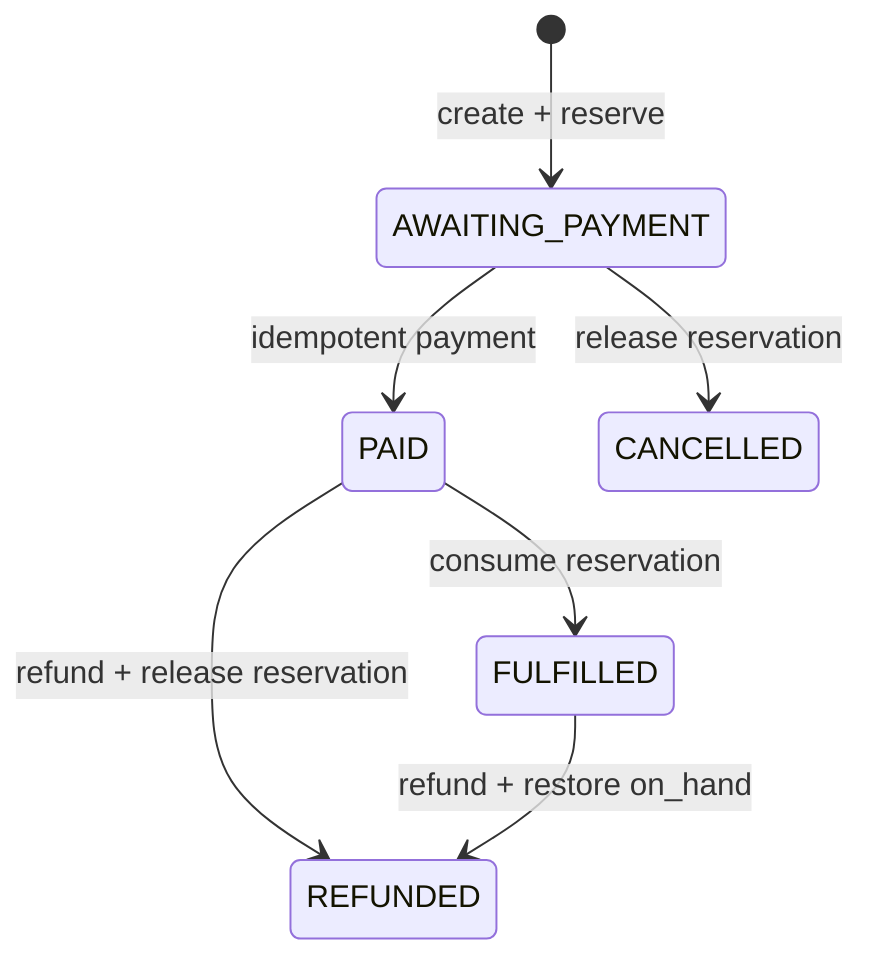

# WEEK-33 - SUT 商业闭环与真实业务事实 / Commerce Vertical Slice and SUT Business Facts

- 计划 / Plan: Week 33，commerce vertical slice、真实移动端业务链、库存和支付一致性
- 日期范围 / Date Range: 2026-11-22
- 分支 / Branch: `study/week-32-comprehensive-acceptance`
- 基线提交 / Base Commit: `f6ed98a`
- 计划提交 / Plan Commit: Not committed
- Pull Request: Not opened

## 计划目标 / Plan Goal

本计划把业务验收从 fixture 自证推进到真实 SUT 业务事实：

```text
真实 Android 客户端
-> 创建订单
-> PostgreSQL 库存预留
-> 幂等支付
-> 履约消费库存
-> API / PostgreSQL / Redis 交叉验证
```

验收边界是单商品、单订单的窄闭环，不建设完整电商平台，也不接真实支付渠道。
fixture 可以准备数据和驱动 UI，但订单、库存、支付和最终状态必须由 SUT 决定。

English summary: prove one narrow but complete commerce flow through real SUT
transactions, including stock reservation, idempotent payment, fulfillment,
cancellation, refund compensation, weak-network retry, and mobile evidence.

## 完成状态 / Completion Status

本机与物理 Android 验收为 **通过 / PASS**。

仓库级完成状态仍为 **部分通过 / PARTIAL**，因为本轮没有提交、推送或执行新的
GitHub Actions 运行。不能把本地 PASS 写成 CI PASS。

实际执行：

- Windows 项目 Python 环境。
- 独立 Compose project `qa-commerce-w33`，使用自定义端口 `18010/15442/26389`。
- 物理 Redmi K50、Android 14、UiAutomator2。
- Toxiproxy 真实延迟故障。

## 完成范围 / Scope

- 新增 `inventory`、`orders`、`order_lines`、`inventory_reservations`、
  `payments`、`order_events` 六张表。
- 新增库存设置/读取、订单创建/读取、支付、履约、取消和退款 API。
- PostgreSQL 是最终事实源，Redis 只保存可重建的订单读模型。
- 写操作使用 workspace 级幂等键；订单行、支付和库存预留有数据库唯一约束。
- 行锁串行化同一订单的并发支付，只有一个支付能成功。
- 取消会释放预留；支付前退款释放预留；履约后退款恢复 `on_hand`。
- Android 客户端新增创建订单、支付、履约按钮，并显示 SUT 返回的订单状态。
- 真实设备跨层测试覆盖 UI、API、PostgreSQL 和 Redis。
- Toxiproxy 测试覆盖支付超时后使用同一幂等键重试。
- Android Linux CI 脚本已加入 commerce 跨层测试。

## 业务状态机 / Business State Machine



支付记录：

```text
PENDING -> SUCCEEDED -> REFUNDED
PENDING -> FAILED
```

本轮没有构造正常支付失败，因为本地支付适配器只模拟成功结算；失败失败路径留给后续
可控支付依赖。超时与重复提交已经覆盖。

## 质量检查 / Quality Checks

| 检查项 / Check | 结果 / Status | 执行环境 / Environment | 证据 / Evidence |
| --- | --- | --- | --- |
| Ruff | PASS | Windows | `All checks passed!` |
| Mypy | PASS | Windows | `Success: no issues found in 239 source files` |
| Unit tests | PASS | Windows | `399 passed` |
| Commerce focused tests | PASS | Windows + Compose SUT | `16 passed` |
| Integration tests | PASS | Windows + Compose SUT | `46 passed` |
| Full API tests | PASS | Windows + Compose SUT + Toxiproxy | `254 passed` |
| Android build | PASS | JDK / Android SDK 35 | `fixture-debug.apk` installed |
| Physical Android commerce E2E | PASS | Redmi K50 / Android 14 | `1 passed in 14.34s` |
| Weak-network payment retry | PASS | Toxiproxy / real SUT | `1 passed` |
| GitHub Actions | NOT RUN | GitHub | No pushed commit in this task |
| iOS commerce client | NOT RUN | iOS | Commerce UI is Android-only in this slice |

## 验收方式 / Acceptance Method

### 前置条件 / Preconditions

- 独立 Compose project，避免覆盖已有测试卷。
- 新 PostgreSQL volume，确保 `003_commerce.sql` 被初始化。
- Toxiproxy profile 用于弱网测试。
- Appium 2.19.0、UiAutomator2、Android fixture APK。

### 执行命令 / Commands

```powershell
$env:QA_API_PORT='18010'
$env:QA_POSTGRES_PORT='15442'
$env:QA_REDIS_PORT='26389'
docker compose -p qa-commerce-w33 `
  -f apps/compose/compose.yaml `
  --profile fault-injection up --detach --build --wait
```

```powershell
$env:QA_API_BASE_URL='http://127.0.0.1:18010'
$env:QA_POSTGRES_DSN='postgresql://qa:qa@127.0.0.1:15442/qa'
$env:QA_REDIS_URL='redis://127.0.0.1:26389/0'
& 'D:\Codex projects\Appium 2 study\.venv\Scripts\python.exe' `
  -m pytest tests/api tests/integration -q
```

```powershell
powershell -NoProfile -ExecutionPolicy Bypass `
  -File 'apps\android-fixture\build.ps1' `
  -Serial XGZLFIHUUSQOJZFA
```

### 预期结果 / Expected Results

```text
API:             254 passed
Integration:      46 passed
Android E2E:       1 passed
Payment records:   1 for duplicate/concurrent/replayed payment
Final inventory:  on_hand restored on refund; reserved=0
```

### 证据路径 / Evidence

- API JUnit：`artifacts/week33-commerce/api-junit.xml`
- Unit JUnit：`artifacts/week33-commerce/unit-junit.xml`
- Integration JUnit：`artifacts/week33-commerce/integration-junit.xml`
- Android APK：`artifacts/android-fixture/fixture-debug.apk`
- Appium log：`artifacts/week33-commerce/appium/stdout.log`
- ADR：`docs/adr/0016-commerce-vertical-slice.md`

## 未验证项 / Unverified Items

- 新 GitHub Actions run：`NOT RUN`。
- 提交、推送和 PR：`NOT RUN`。
- iOS commerce 客户端：`NOT RUN`，本轮只实现 Android。
- 真实支付服务、3DS、退款渠道回调：不在本轮范围。
- 多商品购物车、优惠、税费和拆单：不在本轮范围。
- 支付失败状态：数据库契约支持，但本轮没有真实失败注入用例。

## 变更文件 / Files Changed

- `apps/compose/postgres/init/003_commerce.sql`
- `apps/compose/api/app.py`
- `apps/android-fixture/src/com/example/qaweek15/MainActivity.java`
- `packages/qa_core/contracts/api.py`
- `packages/qa_core/contracts/openapi.py`
- `packages/qa_core/data_factories/commerce.py`
- `packages/qa_core/db/schema.py`
- `packages/qa_core/cache/commerce.py`
- `tests/api/test_commerce.py`
- `tests/api/test_commerce_weak_network.py`
- `tests/e2e/test_commerce_cross_layer.py`
- `scripts/run_android_linux_smoke.sh`
- `docs/adr/0016-commerce-vertical-slice.md`

## 风险与限制 / Risks and Limitations

- `003_commerce.sql` 位于 Compose init 目录；已有 volume 不会自动执行它。部署到
  持久测试环境前需要正式 migration 或重建测试 volume。
- Android 使用短生命周期 E2E session capability，而不是在 Java 客户端重新实现
  OAuth 登录。业务写入仍经过真实 SUT 服务、事务和数据库，但认证适配器是测试专用。
- Redis 读模型与 PostgreSQL 写事务不是原子提交。本轮测试验证写后刷新和可重建
  读模型，但没有完成 Redis 持久故障下的 reconciliation job。
- 本地支付是确定性适配器，不是外部支付网络。

## 下一步 / Next Plan

1. 提交并推送本分支，运行新 GitHub Actions，确认 API、Compose SUT 和 Android
   Linux emulator 三条真实路径。
2. 增加 CI artifact 校验：订单 ID、payment ID、request ID、幂等键和数据库行。
3. 增加支付失败注入和 Redis 故障后的 reconciliation。
4. 只有 CI 和所有必需环境通过后，才把 Week 33 从 `PARTIAL` 提升为 `PASS`。
